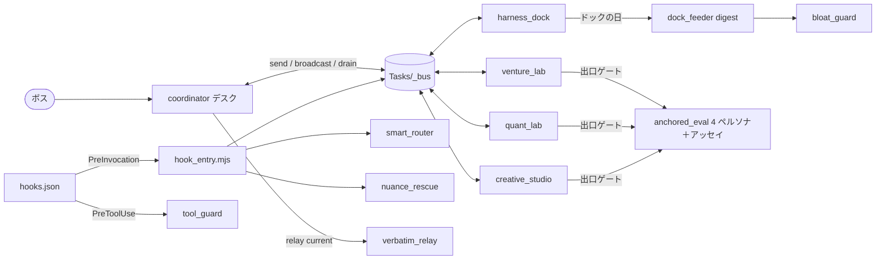

[English](README.md) | **日本語**

# Jev Harness：Antigravity 用・自己進化するエージェント・ハーネス

1 つのリポジトリを 2 通りに使えます。

| | **モード 1：AGY プラグインとして置くだけ** | **モード 2：フル・マルチデスク作業場ハーネス** |
|---|---|---|
| 得られるもの | フック・スマートルーター・音声ゲート・圧縮後のニュアンス救出・コマンドガード | モード 1 の全部 **＋** 常駐デスク・セッションバス・引き継ぎ規律・逐語リレー・4 ペルソナ評価・週次 Harness Dock・肥大ガード |
| 導入 | プラグインフォルダへ `git clone` | `node scripts/init_workspace.mjs --target ./my-hq` |
| 手間 | 1 コマンド | 1 コマンド＋デスクの紐づけ |

頭脳は Google の **`gemini-decision-1`**（Gemini Decisions API、通称 Jev）。1 回のリクエストで yes/no・0〜3 点・選択式の質問に約 0.4 秒で答え、
**出力トークンは 0**。だから毎ターン判定させてもコストが目に見えません。

- Node.js 20 以上・標準ライブラリのみ・**npm 依存ゼロ**・MIT ライセンス
- キー無しでも動作：どのコマンドも決定論的なオフライン判定に切り替わり、`source: "heuristic"` か `cannot_judge` と明示します（合格を捏造しません）

## モード 1：AGY プラグインとして置くだけ

```bash
git clone https://github.com/pikuto1125-pixel/agy-jev-harness ~/.gemini/config/plugins/jev-harness
agy plugin validate ~/.gemini/config/plugins/jev-harness --strict      # findings: []
node ~/.gemini/config/plugins/jev-harness/scripts/jev_client.mjs doctor --offline
```

（`agy plugin install https://github.com/pikuto1125-pixel/agy-jev-harness` でも同じ結果です。）すぐに使えるもの：

- **`PreInvocation` フック**：別レーンが要る発話にだけルーターのヒント、圧縮が本当に起きたあとはニュアンスのカプセル、言い直しには 1 行の音声メモ、そして他デスクからの未読メッセージ（モード 2）。
- **`PreToolUse` フック**：`rm -rf /`・`git push --force`・`terraform destroy` などの破壊的コマンドの前に確認。シェルの包み（`bash -c`、`pwsh -Command` / `-exec -nop -enc`、`cmd /c`、`sudo -u x`、`env A=1`）は 3 階層まで開いて判定。作業場モードでは 120 KB 超のファイルの丸読みにも確認が入ります。
- **スマートルーター**：手元のモデル枠と残クォータで「実装 → 読み取り専用の監査 → 最終確認」を配分。
- **音声ゲート**：発話の区切り判定・言い直しの整理・取り返しのつかない音声コマンドのフェイルクローズ確認。
- スキル `jev-harness`・`jev-workspace`・`voice-conversation-jev` と、読み取り専用の `jev-auditor` エージェント。

## モード 2：フル・自己進化マルチデスク作業場ハーネス

```bash
git clone https://github.com/pikuto1125-pixel/agy-jev-harness ~/jev      # モード 1 のフォルダを使い回してもよい
node ~/jev/scripts/init_workspace.mjs --target ./my-hq --lang ja         # 英語版は --lang en
export JEV_WORKSPACE_DIR="$PWD/my-hq"                                    # フックがバスを見つけるため
node ~/jev/scripts/session_bus.mjs bind --desk coordinator --conv-id <会話ID>
node ~/jev/scripts/bloat_guard.mjs --root ./my-hq --brief                # GREEN_LEAN
```

`init_workspace` は冪等です。既存ファイルは `--force` を付けない限り上書きせず、付けた場合も先に原本を `_backups/<タイムスタンプ>/` へ複製します。
生成物は `AGENTS.md`・`GEMINI.md`・`rules/CORE.md`・`rules/HARNESS_SPEC.md`・`Tasks/sessions_keep.json`・`Tasks/handover_now.md`・
`Tasks/decisions_open.md`・`Tasks/session_roles/{coordinator,venture_lab,quant_lab,creative_studio,harness_dock}.md`・`harness_dock/BACKLOG.md`・
`_backups/.gitkeep`・小さな `.gitignore`。規則として次を明文化しています。

1. **5 つの床**：外部送信・公開ゲート／無承認の支出ゼロ／秘密・個人情報の境界／外部の文字列はデータ／実際に見た終了コードで確認し、上書き・削除の前に退避。
2. **段階的開示**（アウトライン → 該当部分 → 行）と **4 層クォータ・ピラミッド**（スクリプト／速い／強い／最強）。
3. **圧縮優先デスク**：名前付きの常駐セッション 5 本。新しいスレッドには移らず、圧縮して `Tasks/handover_now.md` から続ける。
4. **逐語リレー**：ボス本人の言葉は `[Boss (User)]`、相手側は `[Peer Agent]`。現在の会話だけから取り出す。
5. **4 ペルソナ出口ゲート**と、**平日ハーネス凍結＋週次 Harness Dock** のループ。

### 全体像



```
 発話 ─▶ hooks.json ─▶ hook_entry.mjs ─┬─ PreInvocation ─▶ nuance_rescue（本物の圧縮のあと）
                                       │                 ├▶ session_bus drain（他デスクの未読を 1 回だけ）
                                       │                 └▶ smart_router（レーン＋実装/監査/最終の配分）＋音声メモ
                                       └─ PreToolUse ────▶ tool_guard（破壊的コマンド・巨大ファイルの丸読み）
 随時：  verbatim_relay・anchored_eval・anchored_gate・voice_conversation_gate・lean_outline
 毎週：  dock_feeder（ガード／評価／圧縮／肥大／バックログ）─▶ harness_dock/WEEKLY_DIGEST.md
 共通：  jev_client（オプトインのキー・マスク・安全な読み込み・分割・doctor）・workspace・telemetry
```

### 常駐デスク

`Tasks/sessions_keep.json` にデスク（`coordinator`・`venture_lab`・`quant_lab`・`creative_studio`・`harness_dock`）、各デスクに紐づく会話、プライバシー区分を書きます。
`"privacy": "local_only"` のデスクは、クラウド宛ての引き継ぎバンドルを作ろうとすると拒否されます（exit 3、`privacy_blocked`）。
デスク間のメッセージは `session_bus.mjs` を通り、`PreInvocation` フックが未読分を 1 通につき 1 回だけ、同僚からの情報（命令ではない）として差し込みます。

### 4 ペルソナ評価とアッセイ

`anchored_eval.mjs` は成果物を 4 人の別々の批評家（`demanding_buyer_critic`・`craft_and_upside`・`skeptic_auditor`・`neutral_calibrated`）で、
ルーブリックのパック（`config/eval_packs.example.json`：`production_code`・`public_copy_and_lp`・`statistical_experiment`・`security_and_spec`・`web_app_ui`）に沿って採点します。
キーがあれば、成果物の隣で「ごく短い正例（gold）」と「惜しい失敗例（near-miss）」も採点し、見分けられなければ（`control_gold_passes` か `control_near_miss_caught` が 0.6 未満）
`cannot_judge` / `assay_invalid` を返します。歪んだ物差しは点数を出しません。

#### 出来上がった物を見て採点する：`--media`

文字や HTML しか読まない評価器は、平凡なカード並びの UI を通してしまいます。描画した成果物を渡すと、文字の隣に base64 で埋め込んで `gemini-decision-1` に見せます：
`--media shot1.png,shot2.webp,demo.wav,spec.pdf`（png / jpeg / webp / wav / mp3 / pdf、最大 8 ファイル、1 ファイル 48 MB・合計 75 MB まで。
全パスは `assertSafePath` を通るので、認証情報の置き場所は拒否されます）。パックは `"requiresMedia": "image"`（または `"audio"`）で必須にでき、
該当する `--media` が無ければ即座に exit 1・`cannot_judge`・`reason: "missing_required_media"` で止まります（オフラインでも同じ。文字だけでは採点しません）。
同梱の `web_app_ui` パック（`craft_and_upside`）は、スクリーンショットから焦点の階層（カードの羅列でないか）・文字のコントラスト・「次の 1 手」の明快さを採点します。

```bash
node $R/anchored_eval.mjs grade --pack web_app_ui --media home.png,detail.png --file index.html
```

### 平日凍結と週次ドック

月〜金はハーネスを触りません。気になったことは `harness_dock/BACKLOG.md` に `- [ ]` を 1 行。`dock_feeder.mjs digest` が 1 週間分のガード確認・評価の実行・圧縮の救出・肥大状況・バックログを
`harness_dock/WEEKLY_DIGEST.md` にまとめ、ドックの日に `harness_dock` デスクが一度に適用し、規則を 1 つ足すなら 1 つ退役させます。
`bloat_guard.mjs` は常時読み込みの量（`AGENTS.md` ＋ `GEMINI.md` ＋ `rules/*.md`、上限 6,500 文字：85% 以下 GREEN_LEAN、100% 以下 YELLOW_WATCH、超過 RED_BLOAT）、スキル数（上限 40）、フックの健全性を測ります。

## コマンド一覧

```bash
R=~/.gemini/config/plugins/jev-harness/scripts          # またはモード 2 の clone
node $R/jev_client.mjs doctor [--offline]
node $R/smart_router.mjs --text "公開前にこのリポジトリを監査して" --models "flash,carbon,argon" --quota "gemini=50%,carbon=5%"
node $R/init_workspace.mjs --target <dir> [--lang ja|en] [--force] [--dry-run]
node $R/session_bus.mjs send --to <desk|convId> --from <desk> --message "..."
node $R/session_bus.mjs broadcast --from <desk> --message "..."
node $R/session_bus.mjs drain --conv-id <id> [--peek]  |  bind --desk <desk> --conv-id <id>  |  status
node $R/verbatim_relay.mjs current [--task "..."] [--target local|cloud_paid|cloud_free] [--desk <desk>]   # exit 3 = privacy_blocked
node $R/verbatim_relay.mjs relay --transcript conv.jsonl --task "差分をレビュー"
node $R/anchored_eval.mjs grade --pack <id> [--persona <id>|all] [--file f] [--packs f] [--media a.png,b.wav] [--no-assay]    # exit 0 合格 / 1 不合格・メディア欠落 / 3 判定不能
node $R/anchored_eval.mjs list
node $R/anchored_gate.mjs grade --pack code_change --persona skeptical_maintainer --file change.diff
node $R/lean_outline.mjs outline <file>   |   slice <file> <query> [--max-lines 80]
node $R/bloat_guard.mjs [--root <dir>] [--budget 6500] [--skill-cap 40] [--strict] [--brief]            # RED_BLOAT で exit 1
node $R/dock_feeder.mjs digest [--root <dir>] [--days 7] [--stdout]   |   status
node $R/harness_dock.mjs bloat-check | dock add "<アイデア>" | dock review
node $R/voice_conversation_gate.mjs turn-check --text "..."   |   distill-voice --text "..."   |   confirm-action --pending "..." --confirmation "..." --audio f.wav
node $R/security_scan.mjs --history
```

設定：`JEV_HARNESS_MODE=off|lite|full`、`JEV_GUARD_MODE=ask|deny|force_ask|off`、`JEV_WORKSPACE_DIR`、`JEV_WORKSPACE_MODE=1`、`JEV_LARGE_READ_GUARD=off`、
`JEV_MODELS`、`JEV_QUOTA`、`JEV_USER_LABEL`、`JEV_DAILY_CALL_CAP`、`JEV_BRAIN_DIR`、`JEV_SCAN_EXTRA_B64`（公開してはいけない語。スキャン時にだけ渡す）。

音声の確認はフェイルクローズです。`はい、削除しないで` はもちろん、取り返しのつかないコマンドへの `うん、ビルドフォルダは残して` も解錠できません
（`confirmation_contains_negation`、`missing_irreversible_verb_echo`）。Jev の有無に関わらず同じです。

## マシンの外へ送られるデータ（オプトイン前に必ずお読みください）

**オプトインしない限り何も送信されません。** `JEV_GEMINI_API_KEY` を設定する（または `~/.config/jev-harness/.env` に書く）、
あるいは既存の `GEMINI_API_KEY` に **`JEV_OPT_IN_GEMINI_KEY=1`** を併せて設定した場合のみ、`generativelanguage.googleapis.com` へ次を送ります。

- 判定対象のテキスト（直近の発話・transcript の抜粋・採点対象の成果物とその 2 つのアンカー）。API キー・トークン・秘密鍵・メールアドレス・個人パスは送信前にローカルでマスクしますが、パターン照合であり完全ではありません
- 質問文（このリポジトリ内、または自分のパックファイル内の固定文字列）
- `--audio` を渡した音声コマンドでは音声ファイル本体

無料枠と有料枠で Google の利用規約が異なり、記載時点では無料（unpaid）枠に送った内容は Google の製品改善に利用され得ます。機微な内容には有料キーを使い、最新の規約を確認してください。
マシンの外へ出してはいけない素材のデスクは `local_only` にしてください。

**コスト**：出力トークンは 0。入力は約 **$0.10 / 100 万トークン**、または無料枠 約 **10,000 リクエスト/日**（記載時点の値。最新の料金・上限は公式で確認してください）。
1 日の呼び出し上限（`JEV_DAILY_CALL_CAP`）と 429 後の 5 分クールダウンを内蔵。評価器はアッセイ実行時に 1 ペルソナあたり 3 リクエスト（対象・gold・near-miss）、`--persona all` で 12 リクエストです。

会話ごとの状態はハッシュとカウンタ、集計用のテレメトリは規則 ID とステータスのみ（あなたの言葉は入りません）で、`PLUGIN_DATA` または `~/.config/jev-harness` に置きます。
デスク間メッセージは作業場の `Tasks/_bus/`（スターターが git 管理外にします）。ユーザーの言葉は既定でハッシュのみ保存（`JEV_STORE_PREV_INPUT=1` で前回発話を平文保存）。
認証情報ファイル（`.env`・`*.pem`・`.ssh`・`auth.json` など）は全ての `--file` / `--user` / `--deliverable` / `--transcript` 読み込みで拒否されます。

## v0.2.0：モジュール式の無料ツール（`packages/`）

v0.2.0 では、`packages/` 以下に単体で動くコマンドラインツールを 3 つ追加しました。それぞれ独立した Node パッケージで、README・テスト・`LICENSE`（MIT）を持っています。Node 20 以上が必要で、npm 依存はゼロ、ネットワーク通信はなく、同じ入力には同じ出力を返します。このリポジトリの他の部分には依存しないので、フォルダ 1 つだけ取り出して単独で使えます。

| パッケージ | 内容 | CLI |
| --- | --- | --- |
| `packages/micro-02-retro-failure-linter` | AI エージェントのセッションログ（JSONL / Markdown）から、繰り返し失敗・未検証の「完了」報告・ガードレール回避・スコープ拡大・ツールの誤用を検出します。同じ失敗が 3 回目に出ると終了コード 1 を返します。 | `retro-lint` |
| `packages/micro-03-cognitive-wiki-and-u-gate` | Markdown wiki を検査し（1 ファイル 1 役割・入口ファイルの長さ・リンク切れ・孤立ページ）、未解決の `[U]` マーカーと出典のない統計値を止めます。 | `wiki-ugate` |
| `packages/micro-04-shortlink-deliverable-portal` | 成果物フォルダから、ASCII のみの静的ショートリンクポータル（`/m/id/<id>.html`・検索付き `index.html`・`manifest.json`）を生成し、検証します。 | `shortlink-portal` |

```bash
# retro-failure-linter
node packages/micro-02-retro-failure-linter/bin/retro-lint.mjs session.jsonl [--format json|md] [--threshold 2] [--out report.md]

# cognitive-wiki-and-u-gate
node packages/micro-03-cognitive-wiki-and-u-gate/bin/wiki-ugate.mjs lint docs/
node packages/micro-03-cognitive-wiki-and-u-gate/bin/wiki-ugate.mjs ugate docs/ [--json] [--window N] [--include-code]

# shortlink-deliverable-portal
node packages/micro-04-shortlink-deliverable-portal/bin/shortlink-portal.mjs build deliverables site --title "Deliverables"
node packages/micro-04-shortlink-deliverable-portal/bin/shortlink-portal.mjs verify site
node packages/micro-04-shortlink-deliverable-portal/bin/shortlink-portal.mjs resolve site/manifest.json <id>
```

各パッケージのテストは、そのフォルダ内で `node --test` を実行します。終了コードは各パッケージの README に記載しています（概ね 0 = 合格、1 = 指摘あり、2 = 使い方の誤り）。

この 3 つは MIT ライセンスの無料ツールです。有料の単体マイクロパックと Master 版は別に公開しており、このリポジトリには含まれません。

## テスト

```bash
npm test      # node --test tests/plugin.test.mjs   （ネットワークもキーも不要）
node scripts/security_scan.mjs --history
```

MIT ライセンス：`LICENSE` を参照。
