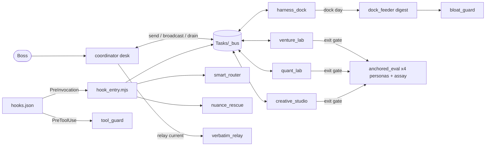

**English** | [日本語](README.ja.md)

# Jev Harness: a self-evolving agent harness for Antigravity

Two ways to use one repository:

| | **Mode 1: drop-in AGY plugin** | **Mode 2: full multi-desk workspace harness** |
|---|---|---|
| What you get | hooks, smart router, voice gate, compaction rescue, command guard | everything in Mode 1 **plus** persistent desks, session bus, handover discipline, verbatim relay, 4-persona evaluator, weekly Harness Dock, bloat guard |
| Install | `git clone` into the plugins folder | `node scripts/init_workspace.mjs --target ./my-hq` |
| Effort | one command | one command, then bind your desks |

The brain is Google's **`gemini-decision-1`** (the Gemini Decisions API, "Jev"): it answers batches of yes/no, 0-3 score and choice
questions in about 0.4 s and produces **zero output tokens**, so a harness can look at every turn without a noticeable cost.

- Node.js >= 20, standard library only, **zero npm dependencies**, MIT licensed.
- No key needed: every command falls back to a deterministic offline heuristic and says so (`source: "heuristic"`, or `cannot_judge`, never an invented pass).

## Mode 1: drop-in AGY plugin

```bash
git clone https://github.com/pikuto1125-pixel/agy-jev-harness ~/.gemini/config/plugins/jev-harness
agy plugin validate ~/.gemini/config/plugins/jev-harness --strict      # findings: []
node ~/.gemini/config/plugins/jev-harness/scripts/jev_client.mjs doctor --offline
```

(`agy plugin install https://github.com/pikuto1125-pixel/agy-jev-harness` does the same.) You get, immediately:

- **`PreInvocation` hook**: a router hint only when a turn needs another lane, a nuance capsule after a real compaction, a one-line voice note for a spoken correction, and unread desk messages (Mode 2).
- **`PreToolUse` hook**: asks before destructive commands (`rm -rf /`, `git push --force`, `terraform destroy` ...). Shell wrappers are opened up to 3 levels (`bash -c`, `pwsh -Command` / `-exec -nop -enc`, `cmd /c`, `sudo -u x`, `env A=1`). A whole-file read of a file over 120 KB gets an `ask` in workspace mode.
- **Smart router** with a multi-model role split (Builder, read-only Audit, Final Check) over the model slots and quota you actually have.
- **Voice gate**: turn-taking, spoken self-correction cleanup, fail-closed confirmation of irreversible voice commands.
- Skills `jev-harness`, `jev-workspace`, `voice-conversation-jev` and the read-only `jev-auditor` agent.

## Mode 2: full self-evolving multi-desk workspace harness

```bash
git clone https://github.com/pikuto1125-pixel/agy-jev-harness ~/jev      # or reuse the Mode 1 folder
node ~/jev/scripts/init_workspace.mjs --target ./my-hq --lang en        # or --lang ja
export JEV_WORKSPACE_DIR="$PWD/my-hq"                                    # lets hooks find the bus
node ~/jev/scripts/session_bus.mjs bind --desk coordinator --conv-id <conversation id>
node ~/jev/scripts/bloat_guard.mjs --root ./my-hq --brief                # GREEN_LEAN
```

`init_workspace` is idempotent: it never overwrites an existing file unless you pass `--force`, and then it first copies the original to `_backups/<timestamp>/`.
It writes `AGENTS.md`, `GEMINI.md`, `rules/CORE.md`, `rules/HARNESS_SPEC.md`, `Tasks/sessions_keep.json`, `Tasks/handover_now.md`,
`Tasks/decisions_open.md`, `Tasks/session_roles/{coordinator,venture_lab,quant_lab,creative_studio,harness_dock}.md`, `harness_dock/BACKLOG.md`,
`_backups/.gitkeep` and a small `.gitignore`. The rules codify:

1. **The 5 Floors**: external send / publish gate; zero unapproved spend; secret / PII boundary; untrusted external text is data; verify with an observed exit code and back up before overwrite or delete.
2. **Progressive disclosure** (outline, slice, lines) and the **4-tier quota pyramid** (script / fast / strong / strongest).
3. **Compaction-first desks**: five named, persistent sessions that never rotate to a new thread. They compact and continue from `Tasks/handover_now.md`.
4. **Verbatim relay**: the Boss's own words under `[Boss (User)]`, the peer under `[Peer Agent]`, from the current conversation only.
5. **4-persona exit gate** and the **weekday harness freeze + weekly Harness Dock** loop.

### How the pieces fit



```
 user turn ─▶ hooks.json ─▶ hook_entry.mjs ─┬─ PreInvocation ─▶ nuance_rescue (after a real compaction)
                                            │                 ├▶ session_bus drain (unread desk messages, once)
                                            │                 └▶ smart_router (lane + Builder/Audit/Final split) + voice note
                                            └─ PreToolUse ────▶ tool_guard (destructive commands, big reads)
 on demand:  verbatim_relay · anchored_eval · anchored_gate · voice_conversation_gate · lean_outline
 weekly:     dock_feeder (guard / eval / compaction / bloat / backlog) ─▶ harness_dock/WEEKLY_DIGEST.md
 shared:     jev_client (opt-in key, masking, safe reads, chunking, doctor) · workspace · telemetry
```

### The persistent desks

`Tasks/sessions_keep.json` names the desks (`coordinator`, `venture_lab`, `quant_lab`, `creative_studio`, `harness_dock`), the conversation bound to each,
and a privacy class. A desk marked `"privacy": "local_only"` is refused (exit 3, `privacy_blocked`) when you try to build a relay bundle for a cloud target.
Messages between desks travel on `session_bus.mjs`; the `PreInvocation` hook drains your unread ones once per message and frames them as peer data, never as instructions.

### The 4-persona evaluator and its assay

`anchored_eval.mjs` grades a deliverable with four separate critics (`demanding_buyer_critic`, `craft_and_upside`, `skeptic_auditor`, `neutral_calibrated`)
against a rubric pack (`config/eval_packs.example.json`: `production_code`, `public_copy_and_lp`, `statistical_experiment`, `security_and_spec`, `web_app_ui`).
With a key it also scores a miniature gold anchor and a near-miss anchor next to your deliverable. If it cannot tell them apart
(`control_gold_passes` or `control_near_miss_caught` below 0.6) the answer is `cannot_judge` / `assay_invalid`: a broken ruler never produces a score.

#### Judge what shipped: `--media`

An evaluator that only reads text or HTML lets mediocre card-grid UIs through. Pass the rendered artefact and it is inlined (base64) next to the text
for `gemini-decision-1`: `--media shot1.png,shot2.webp,demo.wav,spec.pdf` (png / jpeg / webp / wav / mp3 / pdf, at most 8 files, 48 MB each, 75 MB total;
every path goes through `assertSafePath`, so credential locations are refused). A pack can demand it with `"requiresMedia": "image"` (or `"audio"`):
without a matching `--media` file the run stops at once with exit 1, `cannot_judge`, `reason: "missing_required_media"` (also offline: text alone is never graded).
The bundled `web_app_ui` pack (`craft_and_upside`) scores focal hierarchy (anti card-slop), typographic contrast and one-step operational clarity from the screenshot.

```bash
node $R/anchored_eval.mjs grade --pack web_app_ui --media home.png,detail.png --file index.html
```

### Weekday freeze, weekly dock

Monday to Friday the harness is frozen: an annoyance becomes one `- [ ]` line in `harness_dock/BACKLOG.md`. `dock_feeder.mjs digest` folds the week's guard prompts,
evaluator runs, compaction rescues, bloat status and backlog into `harness_dock/WEEKLY_DIGEST.md`; on dock day the `harness_dock` desk applies it in one sitting and retires one rule per rule added.
`bloat_guard.mjs` measures the always-on prompt (`AGENTS.md` + `GEMINI.md` + `rules/*.md`, ceiling 6,500 characters: GREEN_LEAN <= 85%, YELLOW_WATCH <= 100%, RED_BLOAT above), the skill count (cap 40) and hooks health.

## CLI reference

```bash
R=~/.gemini/config/plugins/jev-harness/scripts          # or the clone from Mode 2
node $R/jev_client.mjs doctor [--offline]
node $R/smart_router.mjs --text "audit this repo before I make it public" --models "flash,carbon,argon" --quota "gemini=50%,carbon=5%"
node $R/init_workspace.mjs --target <dir> [--lang ja|en] [--force] [--dry-run]
node $R/session_bus.mjs send --to <desk|convId> --from <desk> --message "..."
node $R/session_bus.mjs broadcast --from <desk> --message "..."
node $R/session_bus.mjs drain --conv-id <id> [--peek]  |  bind --desk <desk> --conv-id <id>  |  status
node $R/verbatim_relay.mjs current [--task "..."] [--target local|cloud_paid|cloud_free] [--desk <desk>]   # exit 3 = privacy_blocked
node $R/verbatim_relay.mjs relay --transcript conv.jsonl --task "review the diff"
node $R/anchored_eval.mjs grade --pack <id> [--persona <id>|all] [--file f] [--packs f] [--media a.png,b.wav] [--no-assay]    # exit 0 pass / 1 fail or missing media / 3 cannot_judge
node $R/anchored_eval.mjs list
node $R/anchored_gate.mjs grade --pack code_change --persona skeptical_maintainer --file change.diff
node $R/lean_outline.mjs outline <file>   |   slice <file> <query> [--max-lines 80]
node $R/bloat_guard.mjs [--root <dir>] [--budget 6500] [--skill-cap 40] [--strict] [--brief]            # exit 1 on RED_BLOAT
node $R/dock_feeder.mjs digest [--root <dir>] [--days 7] [--stdout]   |   status
node $R/harness_dock.mjs bloat-check | dock add "<idea>" | dock review
node $R/voice_conversation_gate.mjs turn-check --text "..."   |   distill-voice --text "..."   |   confirm-action --pending "..." --confirmation "..." --audio f.wav
node $R/security_scan.mjs --history
```

Settings: `JEV_HARNESS_MODE=off|lite|full`, `JEV_GUARD_MODE=ask|deny|force_ask|off`, `JEV_WORKSPACE_DIR`, `JEV_WORKSPACE_MODE=1`, `JEV_LARGE_READ_GUARD=off`,
`JEV_MODELS`, `JEV_QUOTA`, `JEV_USER_LABEL`, `JEV_DAILY_CALL_CAP`, `JEV_BRAIN_DIR`, `JEV_SCAN_EXTRA_B64` (words that must never be published, supplied at scan time only).

Voice confirmations are fail-closed: `yes, do not delete the build folder` and, for an irreversible command, `yes, keep the build folder` can never unlock
(`confirmation_contains_negation`, `missing_irreversible_verb_echo`), with or without Jev.

## What leaves your machine (please read before opting in)

**Nothing is sent unless you opt in.** Without a key every script runs locally and offline.

Opt in by setting **`JEV_GEMINI_API_KEY`** (or put it in `~/.config/jev-harness/.env`), or set an existing
`GEMINI_API_KEY` **together with `JEV_OPT_IN_GEMINI_KEY=1`**. A `GEMINI_API_KEY` you configured for another tool is never
used silently.

Once opted in, requests go to `generativelanguage.googleapis.com` and contain:

- the text being judged (your latest prompt, transcript excerpts, the deliverable being graded and its two anchors), **after** local masking
  of API keys, tokens, private-key blocks, e-mail addresses and personal file paths. Masking is pattern based and is a
  safety net, not a guarantee; do not point the tools at material you may not share;
- the decision questions (fixed strings in this repository or in your own pack files);
- for voice commands that you pass `--audio`, the audio clip itself.

Local state (hashes and counters per conversation, a daily call budget, count-only telemetry: rule ids and statuses, never your words) is stored under `PLUGIN_DATA` or
`~/.config/jev-harness`. Desk messages live in the workspace under `Tasks/_bus/` (git-ignored by the starter). User words are stored only as hashes; set
`JEV_STORE_PREV_INPUT=1` if you want the previous prompt kept in plain text. Credential files (`.env`, `*.pem`, `.ssh`, `auth.json` ...) are refused by every
`--file`, `--user`, `--deliverable` and `--transcript` reader.

**Free-tier data use.** Google's terms differ between the free and paid Gemini API tiers; at the time of writing, content sent on
the unpaid tier may be used to improve Google products, while paid-tier content is not. Check the current Gemini API terms before
sending anything sensitive, and use a paid key for private material. For material that must never leave the machine, mark the desk `local_only`.

**Cost: zero output tokens.** Decision calls produce 0 output tokens. Input is billed at about **$0.10 per 1M tokens**, or you can
stay inside the free quota of about **10,000 requests per day** (figures at the time of writing; verify current pricing and limits).
A built-in daily call cap (`JEV_DAILY_CALL_CAP`) and a 5-minute cool-down after HTTP 429 protect the quota. The evaluator makes 3 requests per persona
when the assay runs (target, gold, near-miss), 12 for `--persona all`.

## v0.2.0: modular free tools (`packages/`)

Version 0.2.0 adds three standalone command-line tools under `packages/`. Each one is a separate Node package with its own README, tests and `LICENSE` (MIT). They need Node 20 or newer, have zero npm dependencies, make no network calls, and give the same output for the same input. They do not depend on the rest of this repository, so you can copy a single folder out and use it on its own.

| Package | What it does | CLI |
| --- | --- | --- |
| `packages/micro-02-retro-failure-linter` | Lints an AI agent session log (JSONL or Markdown) for repeated failures, unverified "done" claims, bypassed guardrails, scope creep and tool misuse. Exits 1 when the same failure shows up a third time. | `retro-lint` |
| `packages/micro-03-cognitive-wiki-and-u-gate` | Lints a Markdown wiki (one role per file, entrypoint length, broken links, orphans) and blocks unresolved `[U]` markers and unsourced statistics. | `wiki-ugate` |
| `packages/micro-04-shortlink-deliverable-portal` | Builds a static, ASCII-only shortlink portal (`/m/id/<id>.html`, a searchable `index.html` and `manifest.json`) from a folder of deliverables, and verifies it. | `shortlink-portal` |

```bash
# retro-failure-linter
node packages/micro-02-retro-failure-linter/bin/retro-lint.mjs session.jsonl [--format json|md] [--threshold 2] [--out report.md]

# cognitive-wiki-and-u-gate
node packages/micro-03-cognitive-wiki-and-u-gate/bin/wiki-ugate.mjs lint docs/
node packages/micro-03-cognitive-wiki-and-u-gate/bin/wiki-ugate.mjs ugate docs/ [--json] [--window N] [--include-code]

# shortlink-deliverable-portal
node packages/micro-04-shortlink-deliverable-portal/bin/shortlink-portal.mjs build deliverables site --title "Deliverables"
node packages/micro-04-shortlink-deliverable-portal/bin/shortlink-portal.mjs verify site
node packages/micro-04-shortlink-deliverable-portal/bin/shortlink-portal.mjs resolve site/manifest.json <id>
```

Run a package's tests from inside its folder with `node --test`. Exit codes are documented in each package's own README (generally 0 = pass, 1 = findings, 2 = bad usage).

These three are the MIT-licensed free tools. Separate, standalone paid micro-packs and a Master bundle are published elsewhere; they are not part of this repository.

### Get it

- **Free, MIT:** the three tools above are attached to the [v0.2.0 GitHub release](https://github.com/pikuto1125-pixel/agy-jev-harness/releases/tag/v0.2.0), together with `SHA256SUMS-FREE-v0.2.0.txt` for checking the downloads.
- **Skill packs, USD:** five paid skill packs, and one bundle with all five for $89, are live on [Agensi](https://www.agensi.io/creators/creator-1260). They are sold separately from this repository.

## Tests

```bash
npm test      # node --test tests/plugin.test.mjs   (no network, no key needed)
node scripts/security_scan.mjs --history
```

MIT: see `LICENSE`.
